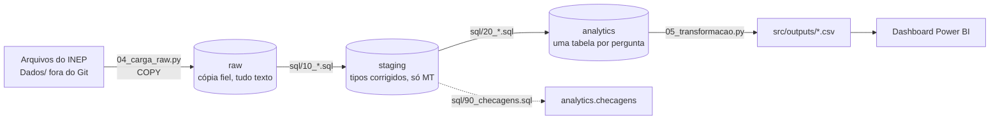

# Arquitetura de ELT — Fases 2 e 3

Equipe Sentinela · DataHack Univag 2026 · Rota do Diploma

O porquê das escolhas e o que a exploração mediu estão em [estrategia.md](estrategia.md). Este documento mostra como o dado anda do arquivo até o dashboard.

## 1. Fluxo



É ELT, e não ETL: o Python só extrai e carrega; toda a transformação é SQL dentro do PostgreSQL, que fica num servidor único para os quatro integrantes.

## 2. Camadas

| Camada | Quem cria | O que tem | Regra |
|---|---|---|---|
| `raw` | `src/04_carga_raw.py` | Uma tabela por fonte: `trajetoria`, `censo_cursos`, `cpc`, `enade_licenciaturas` | Todas as colunas como texto, com `arquivo_origem` e `carregado_em`. Nada é corrigido. |
| `staging` | `src/sql/10_*.sql` | `trajetoria` (pronta); `censo_cursos`, `cpc` e `enade` (a fazer) | Só MT, tipos corrigidos, códigos como texto, nomes iguais entre os anos. |
| `analytics` | `src/sql/20_*.sql` | Uma ou mais tabelas por pergunta, mais `checagens` | Já agregada e com o sigilo aplicado. É o que vai para `src/outputs/`. |

### Nomes das colunas em `raw`

O cabeçalho de cada arquivo é limpo antes de virar coluna: sem acento, sem asterisco, minúsculo, com `_` no lugar de espaço. `' Código do Curso**'` vira `codigo_do_curso`; `CO_CURSO` vira `co_curso`. Assim o mesmo nome serve para todos os anos, mesmo quando o INEP muda a grafia ou a ordem. Coluna que só existe em um ano entra na tabela e fica nula nos demais.

## 3. Tabelas por pergunta

| Pergunta | Tabela em `analytics` | Fonte em `staging` | Situação |
|---|---|---|---|
| P1 — Quanto da turma fica pelo caminho? | `p1_coorte_2015` | `trajetoria` | SQL pronto |
| P2 — Onde a rota mais se perde? | `p2_desistencia_area`, `p2_desistencia_curso`, `p2_ranking_curso` | `trajetoria` | SQL pronto |
| P3 — Pública × privada, presencial × EAD | `p3_*` | `censo_cursos` | A fazer |
| P4 — Qualidade retém? | `p4_*` | `trajetoria` + `cpc` | A fazer |
| P5 — O funil das licenciaturas | `p5_*` | `trajetoria` + `enade_licenciaturas` | A fazer |

Decisões de modelagem que vêm da exploração:

- **Acumulado calculado no banco.** A Trajetória traz conclusão, desistência e falecimento do ano. `staging.trajetoria` soma ano a ano por curso e turma. A conta é conferida contra a taxa de desistência acumulada do próprio INEP.
- **"Ano do curso" em vez de ano civil.** `ano_do_curso = ano_referencia − ano_ingresso + 1`. É o que permite comparar a turma de 2015 com a de 2020 no mesmo ponto da trajetória. O ranking da P2 usa o 5º ano, o último que as seis turmas alcançam.
- **Percentual sobre quem entrou.** Na P1, seguir no curso, concluir, desistir e falecer somam 100% dos ingressantes.
- **Censo agregado antes de juntar.** A linha do Censo é curso × município × ano; `staging.censo_cursos` será agregada para curso × ano antes de qualquer junção por `co_curso`.

## 4. Idempotência

| Etapa | Como garante | Evidência |
|---|---|---|
| Carga em `raw` | Cada arquivo roda em uma transação: apaga as linhas daquele `arquivo_origem` e insere de novo. Se falhar no meio, nada muda. | `src/outputs/carga_raw_contagem.csv` guarda, por execução, quantas linhas havia antes e depois. |
| `staging` e `analytics` | Cada `.sql` apaga e recria as suas tabelas, em uma transação por arquivo. | Rodar `05_transformacao.py` duas vezes gera os mesmos CSV. |

## 5. Qualidade

`src/sql/90_checagens.sql` grava uma linha por teste em `analytics.checagens` (esperado, encontrado, ok), e `05_transformacao.py` mostra o resultado na tela e exporta para `src/outputs/checagens.csv`:

- as linhas de MT em `raw` e em `staging` são as mesmas;
- são 784 cursos distintos, como medido na exploração;
- permanência + conclusão + desistência fecha 100 em todas as linhas;
- quem segue + concluiu + desistiu + faleceu é igual a quem entrou;
- a desistência acumulada calculada bate com a do INEP;
- não há código de curso, município ou área nulo;
- a turma de 2015 presencial tem 41.918 ingressantes;
- nenhuma tabela publicada tem contagem abaixo de 10 alunos.

**Sigilo.** No nível do curso e da área só saem o total de ingressantes e as taxas, e só para quem tem 10 ingressantes ou mais. Na P1, contagem abaixo de 10 sai vazia.

## 6. Como rodar

```
python src/04_carga_raw.py --so-mt     # arquivos -> raw
python src/05_transformacao.py         # raw -> staging -> analytics -> src/outputs/
```

Os SQL rodam na ordem do número no nome do arquivo (`00_`, `10_`, `20_`, `21_`, `90_`).

## 7. Dashboard fora do laboratório

O Power BI lê os CSV de `src/outputs/`, que vão para o Git. O banco não precisa estar acessível na hora do pitch.
