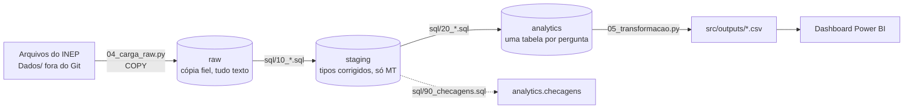

# Arquitetura de ELT — Fases 2 e 3

Equipe Sentinela · DataHack Univag 2026 · Rota do Diploma

O porquê das escolhas e o que a exploração mediu estão em [estrategia.md](estrategia.md). Este documento mostra como o dado anda do arquivo até o dashboard.

## 1. Fluxo



É ELT, e não ETL: o Python só extrai e carrega; toda a transformação é SQL dentro do PostgreSQL, que fica num servidor único para os quatro integrantes.

## 2. Camadas

| Camada | Quem cria | O que tem | Regra |
|---|---|---|---|
| `raw` | `src/04_carga_raw.py` | Uma tabela por fonte. Das perguntas: `trajetoria`, `censo_cursos`, `cpc`, `enade_licenciaturas`. De apoio: `censo_ies`, `igc`, `idd`, `enade`. Do bônus B1: `ibge_populacao` | Todas as colunas como texto, com `arquivo_origem` e `carregado_em`. Nada é corrigido. O JSON do IBGE é só achatado em linhas. |
| `staging` | `src/sql/10_` a `12_*.sql` | `trajetoria`, `censo_cursos` (já agregado para curso × ano), `cpc` e `enade_licenciaturas` | Só MT, tipos corrigidos, códigos como texto, nomes iguais entre os anos. |
| `analytics` | `src/sql/20_*.sql` | Uma ou mais tabelas por pergunta, mais `checagens` | Já agregada e com o sigilo aplicado. É o que vai para `src/outputs/`. |

### Nomes das colunas em `raw`

O cabeçalho de cada arquivo é limpo antes de virar coluna: sem acento, sem asterisco, minúsculo, com `_` no lugar de espaço. `' Código do Curso**'` vira `codigo_do_curso`; `CO_CURSO` vira `co_curso`. Assim o mesmo nome serve para todos os anos, mesmo quando o INEP muda a grafia ou a ordem. Coluna que só existe em um ano entra na tabela e fica nula nos demais.

## 3. Tabelas por pergunta

| Pergunta | Tabela em `analytics` | Fonte em `staging` | Situação |
|---|---|---|---|
| P1 — Quanto da turma fica pelo caminho? | `p1_coorte_2015` | `trajetoria` | Rodando |
| P2 — Onde a rota mais se perde? | `p2_desistencia_area`, `p2_desistencia_curso`, `p2_ranking_curso` | `trajetoria` | Rodando |
| P3 — Pública × privada, presencial × EAD | `p3_rede_modalidade` | `censo_cursos` | Rodando |
| P4 — Qualidade retém? | `p4_curso`, `p4_fatores`, `p4_correlacao` | `trajetoria` + `cpc` | Rodando |
| P5 — O funil das licenciaturas | `p5_funil_turma`, `p5_enade_area`, `p5_funil_resumo`, `p5_curso` | `trajetoria` + `enade_licenciaturas` | Rodando |

Decisões de modelagem que vêm da exploração:

- **Acumulado calculado no banco.** A Trajetória traz conclusão, desistência e falecimento do ano. `staging.trajetoria` soma ano a ano por curso e turma. A conta é conferida contra a taxa de desistência acumulada do próprio INEP.
- **"Ano do curso" em vez de ano civil.** `ano_do_curso = ano_referencia − ano_ingresso + 1`. É o que permite comparar a turma de 2015 com a de 2020 no mesmo ponto da trajetória. O ranking da P2 usa o 5º ano, o último que as seis turmas alcançam.
- **Percentual sobre quem entrou.** Na P1, seguir no curso, concluir, desistir e falecer somam 100% dos ingressantes.
- **Censo agregado antes de juntar.** A linha do Censo é curso × município × ano; `staging.censo_cursos` já sai agregada para curso × ano.
- **Evasão anual da P3.** Desvinculados no ano divididos pelos alunos com vínculo no ano (matriculados + trancados + desvinculados + transferidos + falecidos). Ano atípico é o que tem evasão de pelo menos o dobro da mediana do seu grupo.
- **Um CPC por curso.** Cada edição do CPC avalia um grupo de áreas; `staging.cpc` guarda a edição mais recente de cada curso. A P4 compara com a desistência no 5º ano e só usa cursos com CPC numérico (497).
- **Nota que não é número vira nulo.** "SC" (sem conceito) e células vazias passam pela função `staging.para_numero`, em vez de quebrar a transformação.
- **Funil da P5 com duas fontes.** A desistência vem das turmas de 2015 a 2020; a proficiência, dos concluintes que fizeram o Enade 2025. Não são as mesmas pessoas: o último degrau do funil é uma estimativa e está escrito assim na tabela.

## 4. Idempotência

| Etapa | Como garante | Evidência |
|---|---|---|
| Carga em `raw` | Cada arquivo roda em uma transação: apaga as linhas daquele `arquivo_origem` e insere de novo. Se falhar no meio, nada muda. | `src/outputs/carga_raw_contagem.csv` guarda, por execução, quantas linhas havia antes e depois. |
| `staging` e `analytics` | Cada `.sql` apaga e recria as suas tabelas, em uma transação por arquivo. | Rodar `05_transformacao.py` duas vezes gera os mesmos CSV. |

## 5. Qualidade

`src/sql/90_checagens.sql` grava uma linha por teste em `analytics.checagens` (esperado, encontrado, ok), e `05_transformacao.py` mostra o resultado na tela e exporta para `src/outputs/checagens.csv`:

- as linhas de MT em `raw` e em `staging` são as mesmas;
- são 784 cursos distintos, como medido na exploração;
- permanência + conclusão + desistência fecha 100 em todas as linhas;
- quem segue + concluiu + desistiu + faleceu é igual a quem entrou;
- a desistência acumulada calculada bate com a do INEP;
- não há código de curso, município ou área nulo;
- a turma de 2015 presencial tem 41.918 ingressantes;
- as matrículas do Censo em `raw` e em `staging` somam o mesmo, e 2024 bate com a exploração (189.869 matrículas, 3.890 cursos);
- CPC (558 cursos) e Enade Licenciaturas (97) têm os mesmos cursos em `raw` e em `staging`;
- nenhuma tabela publicada tem contagem abaixo de 10 alunos.

São 18 testes; na última execução todos passaram.

**Sigilo.** No nível do curso e da área só saem o total de ingressantes e as taxas, e só para quem tem 10 ingressantes ou mais. Na P1, contagem abaixo de 10 sai vazia.

## 6. Como rodar

```
python src/04_carga_raw.py --so-mt     # arquivos -> raw
python src/05_transformacao.py         # raw -> staging -> analytics -> src/outputs/
```

Os SQL rodam na ordem do número no nome do arquivo: `00_` schemas, `10_` a `12_` staging, `20_` a `24_` uma pergunta por arquivo, `90_` checagens.

## 7. Dashboard fora do laboratório

O dashboard lê os CSV de `src/outputs/`, que vão para o Git. O banco não precisa estar acessível na hora do pitch.

O protótipo é uma página HTML com os dados embutidos, `src/dashboard/prototipo.html`, gerada por `python src/06_prototipo_dashboard.py`. Abre em qualquer navegador, sem banco e sem internet. As telas e a origem de cada uma estão em [plano_dashboard.md](plano_dashboard.md).
